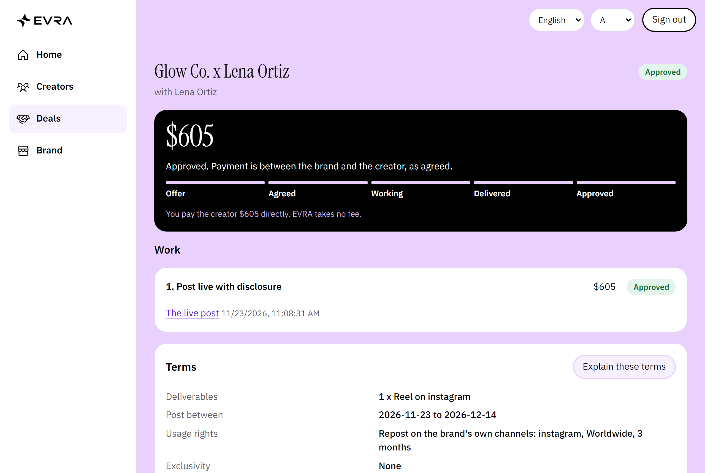
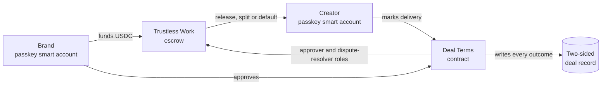
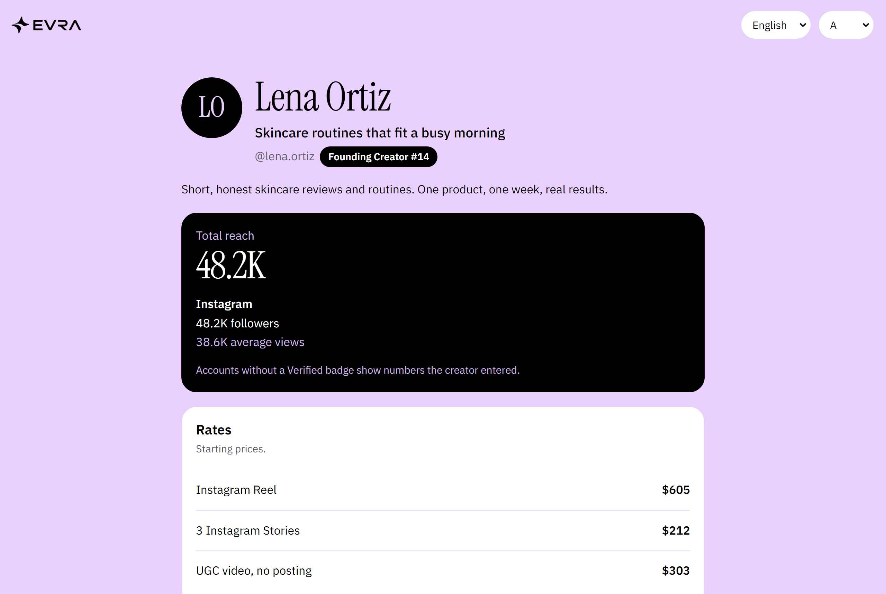
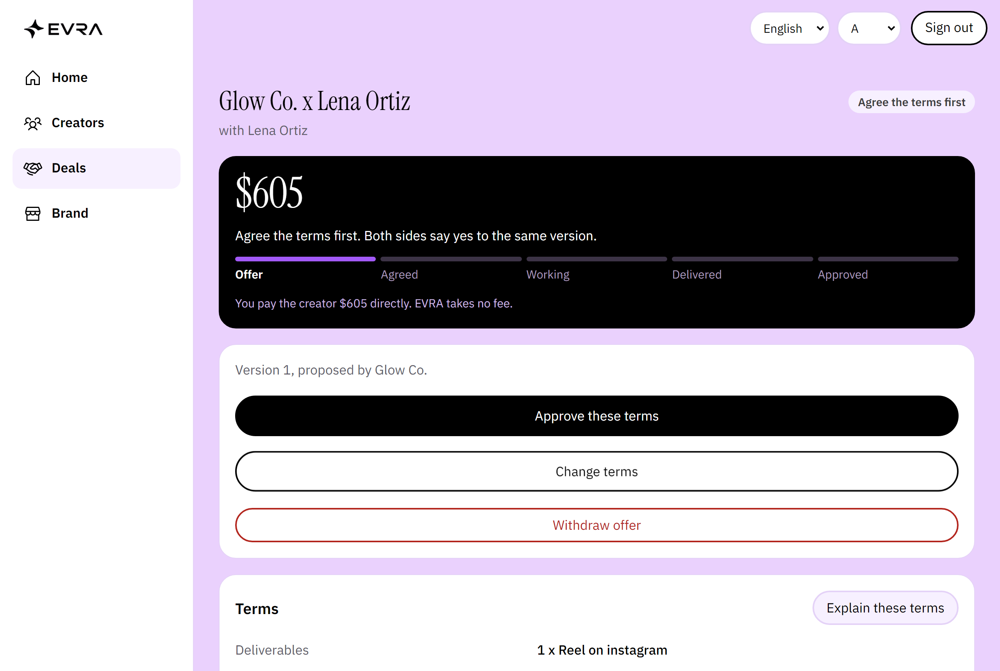

<p align="center">
  
</p>

<h3 align="center">Creator–brand deals with one shared record: the terms, the work and the approval.</h3>

<p align="center">
  <a href="https://github.com/evraworld/evra/actions/workflows/ci.yml"></a>
  <a href="LICENSE"></a>
  
  
  <a href="https://github.com/evraworld/evra/commits/main"></a>
</p>

<p align="center">
  <a href="https://evra.world/demo"><b>Interactive demo</b></a> ·
  <a href="https://docs.google.com/document/d/1FYV3bc_-p3PnW-MqPZMIoaQVhmXjnIJqd4HGwNye1CM/view"><b>Product doc</b></a> ·
  <a href="docs/MILESTONES.md"><b>Testnet milestones</b></a> ·
  <a href="docs/ARCHITECTURE.md"><b>Architecture</b></a> ·
  <a href="https://x.com/evraworld"><b>@evraworld</b></a>
</p>

<p align="center">
  
</p>

## Why EVRA

Most creator–brand deals still run through DMs, spreadsheets and unpaid invoices. Terms change in chat, nobody can say which version was agreed, and when a brand goes quiet after the post is live, the creator has no leverage and no record.

EVRA puts every deal in a **Deal Room**:

1. **Offer.** A brand sends an offer from a creator's public kit, a brief, a request or a challenge.
2. **Agree.** Both sides edit one term sheet (deliverables, usage rights, revisions, kill fee, review window) until they approve the same version. The agreed version is fingerprinted.
3. **Deliver.** The creator sends the draft or the live post. The brand approves, or asks for the revisions the terms allow.
4. **Approve.** If the brand stays silent past the review window, the work is approved by default. Disputes and cancellations follow the agreed terms.

Both sides keep the same record: who proposed what, what was agreed, what was delivered and when it was approved.

**Evra**, the AI assistant, drafts media kits, reviews offers for red flags and suggests counters inside the creator's own limits. It never approves terms, signs or moves money.

## Status

| | What | Status |
| --- | --- | --- |
| Off-chain | Public creator kits at `/@handle`, rate cards, social verification | ✅ Working, in this repo |
| Off-chain | Briefs, requests, challenges, creator search | ✅ Working |
| Off-chain | Deal Room: term versions, approvals, delivery, review window, disputes, ratings | ✅ Working |
| Off-chain | Evra assistant on Claude: kit drafts, offer reviews, counters, deal finder | ✅ Working (needs an API key) |
| Off-chain | Ops console: review queue, kit launcher, support view, dispute desk | ✅ Working |
| On-chain | Passkey smart accounts (Smart Account Kit, Stellar Wallets Kit) | 🛠️ December 2026 |
| On-chain | Deal Terms contract on Trustless Work escrow (Soroban) | 🛠️ December 2026 |
| On-chain | Two-sided deal record written by the contract, with a public page | 🛠️ December 2026 |

Today brands pay creators directly (bank transfer, PayPal or invoice) and EVRA keeps the record. In December the same deal settles on **Stellar testnet** in USDC. Progress is tracked in [docs/MILESTONES.md](docs/MILESTONES.md) and in this repo's milestones and issues.

## Settling deals on Stellar



- **No custody.** Keys stay on people's devices as passkeys. EVRA's servers hold no signing keys and can't move, freeze or recover anyone's funds.
- **No ghosting.** The brand approves at any time. If the brand stays silent past the review window, the creator's own transaction releases the payment. No keeper or EVRA server is needed.
- **No trusted referee.** A dispute settles by a split both sides sign or, after the deadline, by a default anyone can trigger: a full refund if nothing was delivered, otherwise the agreed kill fee to the creator and the rest back to the brand.
- **AI stays out of money.** Evra never signs, approves or releases anything, and it is never used to check delivery.
- **Testnet only.** Mainnet comes only after an independent audit of the Deal Terms contract.

## Traction

- **50+ creators and brands** on the waitlist at [evra.world](https://evra.world).
- An earlier prototype settled a $650 testnet deal on Stellar about 11 seconds after the brand approved. This repo replaces that prototype's custom escrow with Trustless Work's audited one.

## Quick start

You need Node.js 22.12 or later. There is no database to install: the app runs an embedded Postgres ([PGlite](https://pglite.dev)) in `.data/`.

```bash
git clone https://github.com/evraworld/evra.git
cd evra
npm install
cp .env.example .env.local   # then set SESSION_SECRET to 32+ random characters
npm run db:seed              # demo accounts and illustrative rate data
npm run dev                  # http://localhost:3000
```

Sign in at `/signin` as the demo brand `team@glowco.demo.evra.world` or the demo creator `sara.creates@demo.evra.world`. In development, sign-in codes appear at [`/dev/outbox`](http://localhost:3000/dev/outbox) instead of being emailed.

```bash
npm test             # unit tests on an in-memory database
npm run lint
npm run typecheck
npm run build
```

Browser tests (Playwright and axe) are in [`e2e/`](e2e/README.md).

<p align="center">
  
  &nbsp;
  
</p>

## Repository map

| Path | What's there |
| --- | --- |
| `app/(app)` | The signed-in app: Home, deals, briefs, challenges, creators, brand, Ops |
| `app/(auth)` | Sign-in (email code or passkey) and onboarding |
| `app/(public)` | Public pages: creator kits, kit claims, reply links, open work |
| `app/api` | Route handlers. The only way the browser changes data |
| `lib/` | Every rule: deals, requests, challenges, discovery, Ops, AI assistant, auth, i18n |
| `components/` | UI kit and shared components |
| `drizzle/` | SQL migrations generated from `lib/db/schema.ts` |
| `scripts/` | Seed data, scheduled jobs, a 10-brand × 10-creator simulation |
| `tests/`, `e2e/` | Unit tests (Vitest) and browser tests (Playwright) |
| `docs/` | [Architecture](docs/ARCHITECTURE.md), [milestones](docs/MILESTONES.md) |

The Soroban contracts arrive in `contracts/` in December.

## Built with

Next.js 16 · React 19 · TypeScript · Drizzle ORM on Postgres · Zod · Vitest · Playwright · Claude API · Soroban (Rust) and the Stellar SDK for the on-chain work.

## Contributing and security

See [CONTRIBUTING.md](CONTRIBUTING.md) to run, test and propose changes. To report a vulnerability, follow [SECURITY.md](SECURITY.md); please don't open a public issue.

## License

[Apache License 2.0](LICENSE).
