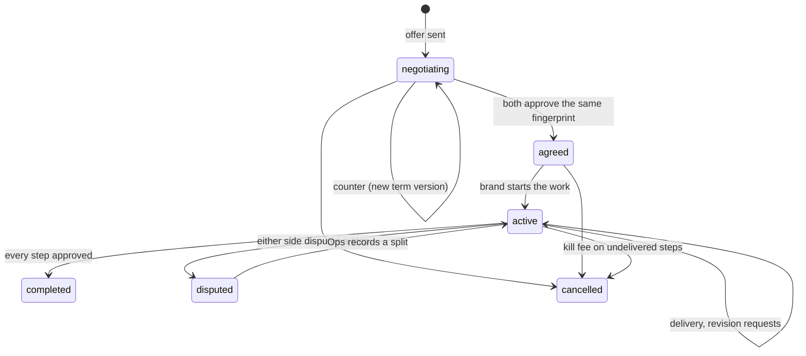

# EVRA architecture

EVRA is one Next.js 16 app (App Router) on one Postgres database. Pages render on the server. Route handlers under `app/api` are the only way the browser changes data, and services in `lib/` hold every rule, so the same code serves the UI, the scheduled jobs and the tests.

```
Browser (signed-in app, public kits and links)
   │
   ▼
app/api/* route handlers ── zod validation, session, plain-words errors (lib/http.ts)
   │
   ▼
lib/ services
   deals/        term sheets, versions, approvals, delivery, review window, disputes, agent policy
   requests/  opportunities/  discovery/  challenges  collectives/  ops/
   ai/           Evra, the assistant: Claude with zod-validated structured output
   auth/         sessions, email codes, passkeys
   │                          │
   ▼                          ▼
Postgres (Drizzle;         Claude API
 PGlite locally)
```

## Deal lifecycle

A deal moves through five states. Every step writes a `deal_events` row, so the timeline both sides see is the audit log.



- **Terms.** Each counter is a new `deal_terms` version. Approvals store the sha256 fingerprint of the exact version (`lib/deals/terms.ts`). Terms lock only when both sides approve the same fingerprint.
- **Review window.** After a delivery the brand has `reviewDays` (5 by default) to approve or ask for a revision. The `autoReleaseDue` job approves silent steps once the window passes.
- **Payments today.** Brands pay creators directly, as written in the terms, and EVRA keeps the record. On-chain settlement is the December work in [MILESTONES.md](MILESTONES.md): passkey smart accounts, a Deal Terms contract on Trustless Work escrow, and a two-sided record written by that contract.

## Evra, the assistant

All model calls go through `lib/ai/claude.ts`. Output is structured and validated against a zod schema, and server-side fallbacks retry a safety decline on Anthropic's recommended model instead of failing the user. The model defaults to Claude Haiku; `EVRA_MODEL` overrides it, and every call's token use is logged.

Autonomy is enforced in code, not in the prompt. At every level the creator's assistant reviews a new offer and flags risks. What it may do next is decided in `lib/deals/agent.ts`:

- **Manual:** nothing more.
- **Copilot:** drafts a counter that waits as an `agent_actions` row with status `proposed` until the creator taps.
- **Delegate:** `delegatePlan` sends counters inside the creator's own range, and declines blocked brands or offers below half their floor.

No code path lets the assistant approve terms or move money.

## Data

One Drizzle schema (`lib/db/schema.ts`) covers identity, kits and social accounts, brands, briefs and requests, deals (term versions, approvals with fingerprints, milestones, submissions, comments, events, disputes, ratings), challenges, collectives, assistant actions, invoices, analytics, and the Ops tables (flags, kit drafts, staff actions, support views, home slots). Money is stored as integer US cents.

`DATABASE_URL` picks the driver: `postgres://…` for a real server, `memory://` for tests, and unset for an embedded PGlite database in `.data/`. Migrations in `drizzle/` run on start.

## Security

- Sessions are random tokens; the database stores only their sha256.
- Email sign-in codes are HMAC-hashed, expire in 10 minutes, allow 5 attempts and 5 codes an hour per address.
- Passkeys use WebAuthn (`@simplewebauthn`), with resident keys and stored counters.
- People outside a deal get a 404, not a 403, so deal ids can't be probed.
- Brand websites are read through an SSRF guard that refuses private addresses on every redirect (`lib/fetchPublic.ts`).
- Reply links, claim links and kit claims store only token hashes, work once and expire. No personal data goes in a URL.
- Staff support views last 30 minutes, need a reason and are logged. They never show messages, invoices or sign-in data.
- Product analytics are first-party; no third-party trackers load in the app.

## Known limits

- Official Instagram, TikTok and YouTube connections need app review with each platform. Until then, stats are labelled self-reported, public profile or demo.
- The embedded database is for local use. Production needs `DATABASE_URL`.
